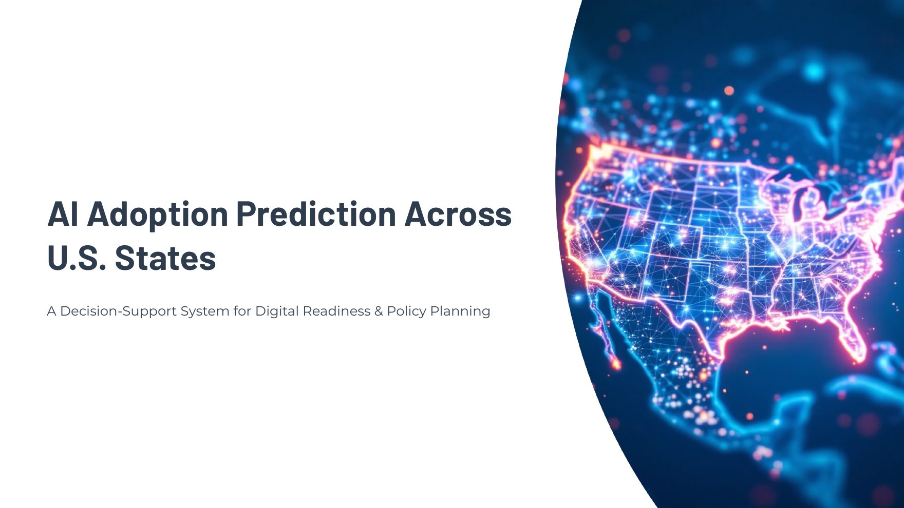
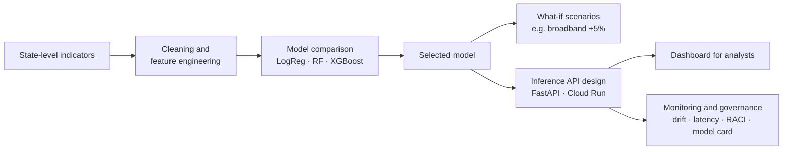
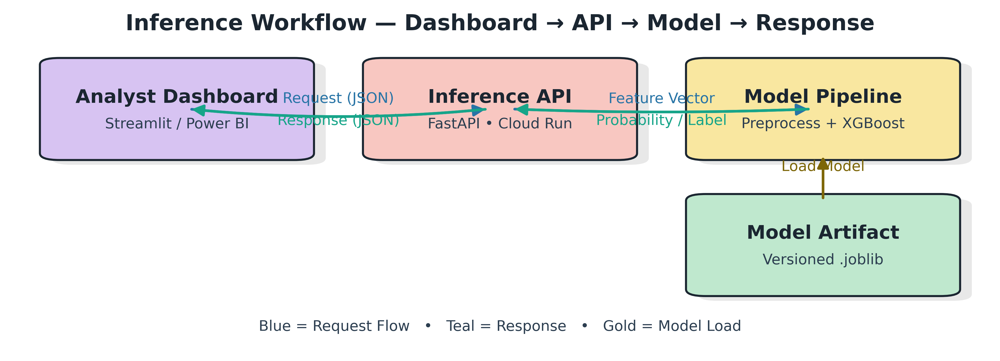
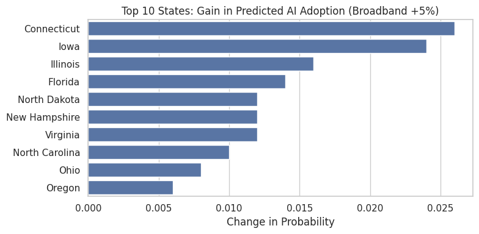
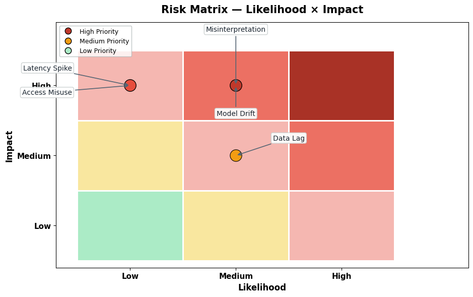
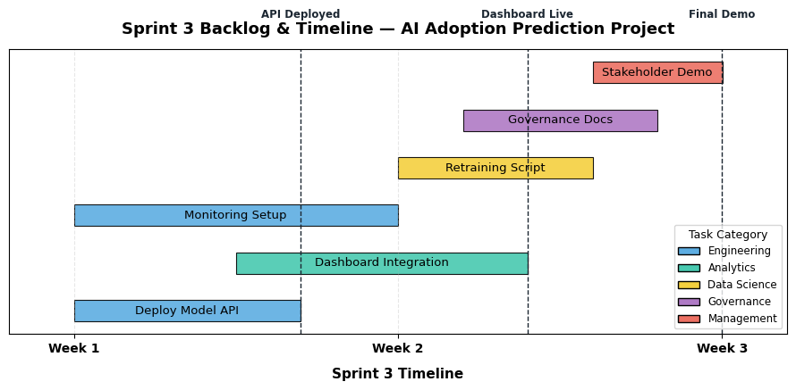

<div align="center">

# AI Adoption Prediction Across U.S. States

**A decision-support model that scores how ready each U.S. state is to adopt AI, and tests which investments would move that readiness most.**


[**View notebook**](AI_Adoption_Prediction.ipynb) · [**Open in Colab**](https://colab.research.google.com/github/PriyamvadaMaan/ai-adoption-prediction/blob/main/AI_Adoption_Prediction.ipynb) · [**Slides (PDF)**](docs/ai-adoption-prediction-slides.pdf)



</div>

---

## The question

AI adoption is uneven across U.S. states. Policy planners, economic teams and investors can see *that* some states are ahead, but not *why*, or where a dollar of investment would make the biggest difference.

This project builds a model that:

1. **Scores** each of the 50 states as high or low AI-adoption potential
2. **Explains** which indicators drive that score
3. **Simulates** what-if scenarios, such as improving broadband access, to show where investment pays off most

It was built over three Agile sprints in my M.S. Project Management program at Clark University, and treated as a full lifecycle project: data, model, deployment design, monitoring and governance.

## At a glance

| Area | Details |
|---|---|
| **Scope** | 50 U.S. states, binary label (high vs. low adoption potential) |
| **Inputs** | Population, small-business counts, broadband access, median income, bachelor's-degree rate, plus engineered and enrichment features |
| **Models compared** | Logistic Regression, Random Forest, XGBoost |
| **Delivery** | 3 Agile sprints, each with a backlog and a documented hand-off |
| **Beyond the model** | Deployment design, monitoring plan, RACI, risk register and model card |

## How it works



## Sprint by sprint

**Sprint 1: Frame the problem and understand the data**
- Defined the goal, users and success metric (ROC-AUC primary; PR-AUC and F1 secondary)
- Built the state-level starter dataset and ran exploratory analysis: distributions, correlations and pairwise driver plots

**Sprint 2: Build, test and select the model**
- Engineered features such as small businesses per 1,000 residents, log income and an income × education interaction
- Removed a leakage column (`Adoption_Score`) and redundant duplicates before training
- Built scikit-learn pipelines (imputation, scaling, one-hot encoding) and compared three models on a stratified 75/25 split
- Added automated data and model tests: binary target, no missing values after preprocessing, stratification preserved within 5%
- Scored a separate holdout file to simulate a new period, and ran the broadband scenario

**Sprint 3: Make it usable and safe to operate**
- Designed the production data flow and an inference service (FastAPI on Google Cloud Run, `/score` endpoint)
- Wrote a monitoring plan with thresholds, owners and an escalation path for drift, latency, prediction confidence, error rate and uptime
- Set up governance: a RACI across six roles, a risk register and likelihood × impact matrix, and a model card

<p align="center">
  
</p>

## Results

Test set: 13 states (stratified 25% split).

| Model | Accuracy | Recall (high-adoption states) | ROC-AUC |
|---|---|---|---|
| Logistic Regression | 0.85 | 0.00 | 0.82 |
| Random Forest | 0.85 | 0.00 | 1.00 |
| **XGBoost** | **0.92** | **0.50** | **1.00** |

**XGBoost was selected.** It was the only model that correctly flagged a high-adoption state in the test set.

**How to read these numbers.** With 50 states and only 6 labeled high-adoption, the test set holds just 2 positive examples. A single prediction swings every metric, so I treat these results as proof that the pipeline works end to end, not as proof of predictive power. Fixing that is the first item under *What I'd do next*.

### What-if: broadband +5%

Raising broadband access by 5 points in every state and re-scoring with the selected model gives the largest gains in Connecticut (+0.026 in predicted probability) and Iowa (+0.024). This is the kind of question the tool was designed to answer for planners: *where does the same investment move readiness most?*

<p align="center">
  
</p>

## Governance and operations

<p align="center">
  
</p>

- **Top risks:** model drift and misinterpretation of readiness scores, both rated medium likelihood and high impact
- **Controls:** drift and latency alerts with named owners, documented model limits, and a model card that states what the score should and should not be used for
- **Ethics:** readiness scores could be used to cut services in low-scoring states rather than improve equity. The governance plan assigns an ethics owner, publishes the model's limits, and treats the score as decision support, never a decision

<p align="center">
  
</p>

## Limitations

I'd rather state these plainly than have a reviewer find them:

- **Small sample.** 50 rows and 6 positive labels limit any statistical claim.
- **Simulated enrichment.** Workforce, STEM-graduate, college, high-school and tech-firm columns were generated to prototype the enrichment step. They are not observed data.
- **Illustrative operations charts.** The monitoring dashboard in Sprint 3 and the feature-importance chart use mock values to demonstrate the reporting design.
- **Deployment is designed, not live.** The API, dashboard and monitoring are specified in the notebook but not running.

## What I'd do next

1. Replace simulated columns with real sources (IPEDS for education, BLS for workforce, Census Business Patterns for tech firms)
2. Move from a binary label to a continuous readiness score, and use cross-validation instead of a single split
3. Compute feature importance from the trained model with SHAP, and rerun the scenarios
4. Stand up the FastAPI service and a minimal dashboard, then run the monitoring plan against real usage

## Run it yourself

```bash
pip install -r requirements.txt
jupyter notebook AI_Adoption_Prediction.ipynb
```

The notebook is saved with all outputs, so you can read it without running anything. Re-running it needs the starter CSV (`ai_adoption_starter.csv`), which is not included in this repository.

## Repository

```
ai-adoption-prediction/
├── AI_Adoption_Prediction.ipynb   # full notebook, all three sprints
├── docs/
│   └── ai-adoption-prediction-slides.pdf
├── images/                        # figures used in this README
└── requirements.txt
```

## What this project shows

I manage AI work for a living, and I built this to understand the full lifecycle from the inside: framing, data, modeling, testing, deployment design, monitoring and governance. Running it in sprints, with backlogs, an issues log and a risk register, is the same discipline I bring to AI data operations programs.

---

**Priyamvada Maan** · Program & Project Manager, AI Data Operations
[Portfolio](https://priyamvadamaan.github.io) · [LinkedIn](https://www.linkedin.com/in/priyamvadamaan) · [GitHub](https://github.com/PriyamvadaMaan)
